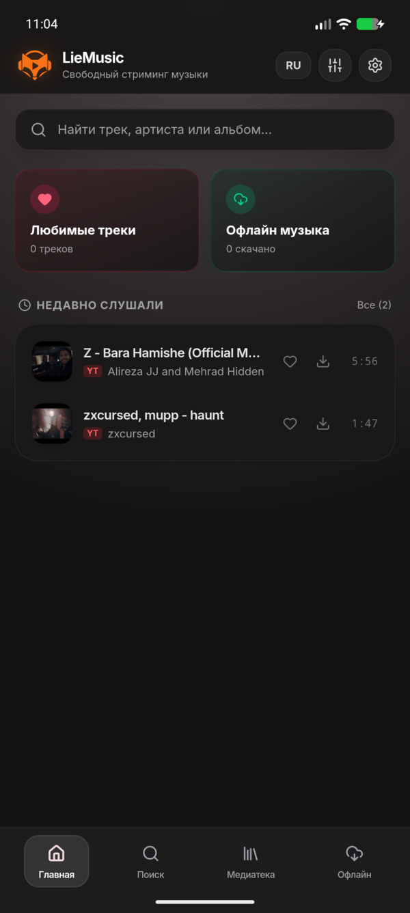
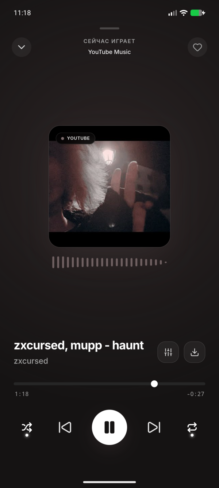
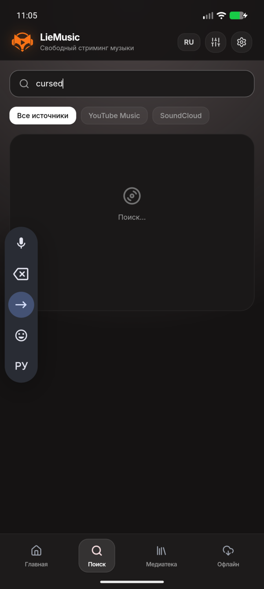
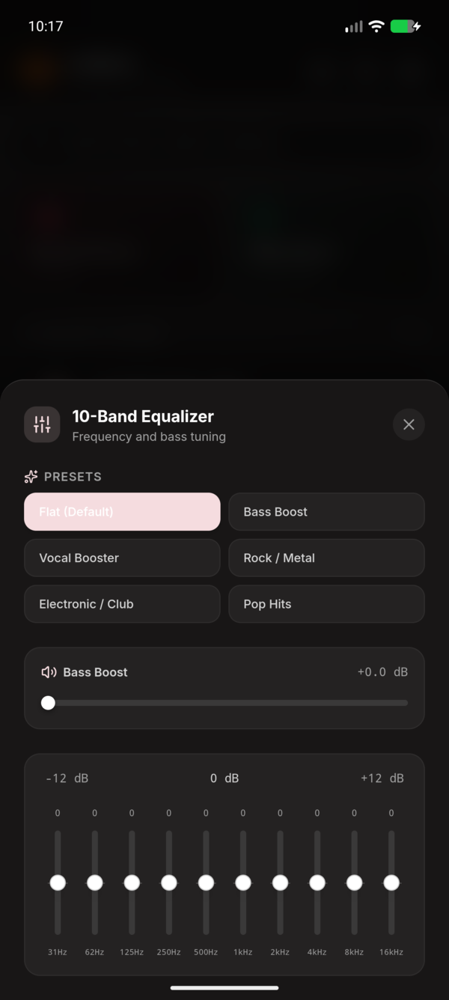

<div align="center">


# LieMusic

**Быстрый, стильный и лёгкий музыкальный плеер для Android с поддержкой YouTube Music, SoundCloud и офлайн-треков.**

[](https://github.com/lie2srvv/LieMusic/releases/latest)
[-blue?style=for-the-badge&logo=android&logoColor=white&color=0ea5e9&labelColor=18181b)](https://github.com/lie2srvv/LieMusic/releases/latest)
[](https://github.com/lie2srvv/LieMusic)
[](LICENSE)
[](https://t.me/lie2srvv)

<br/>

[📥 **Скачать последнюю версию (APK)**](https://github.com/lie2srvv/LieMusic/releases/latest) • [💬 **Связь с автором**](https://t.me/lie2srvv) • [☕ **Поддержать разработку**](https://yoomoney.ru/to/4100119666781214)

<br/>

</div>

---

## ⚡ О проекте

**LieMusic** — современный открытый аудиоплеер для Android, сочетающий в себе доступ к миллионам треков через **YouTube Music** и **SoundCloud**, автономную офлайн-библиотеку и аудиофильский эквалайзер. 

Проект разработан по концепции **Zero-Server / Local-First**: стриминг и загрузка происходят напрямую с открытых CDN без сторонних серверов-посредников, а ваши плейлисты, избранное, история и кэш остаются исключительно на вашем устройстве.

---

## 🌟 Ключевые возможности

- 🔍 **Универсальный стриминг & Поиск**: одновременный поиск и моментальное переключение между каталогами **YouTube Music** и **SoundCloud** с подсказками и умным дебаунсом.
- 🎨 **Адаптивная палитра (Monet Dynamic Color)**: живое извлечение цветовой схемы из обложки текущего трека с мягким окружающим свечением (ambient glow) и адаптивным градиентом плеера.
- 🎚️ **10-полосный эквалайзер & Bass Boost**: точная настройка полос (32 Hz – 16 kHz), усиление низких частот (Bass Boost), виртуализатор объёмного звучания и готовые аудиопресеты (*Rock, Pop, Electronic, Vocal, Flat*).
- 📥 **Офлайн-библиотека**: скачивание треков в память устройства в один клик. Прослушивание без подключения к интернету, режим мультивыбора и пакетное управление локальными треками.
- 🎧 **Нативный фоновый сервис Android**:
  - Полноценная интеграция с **Android MediaSession** — отображение обложки, названия, артиста и прогресса в системной шторке и на экране блокировки.
  - Управление воспроизведением с кнопок проводных и Bluetooth-наушников.
  - Корректная обработка аудиофокуса (приостановка при звонках, уведомлениях и навигаторах).
- 📱 **Edge-to-Edge & Gesture Navigation**: поддержка вырезов под фронтальную камеру (*punch-hole*) и системных жестов Android без наложения элементов управления.
- 🔒 **Конфиденциальность и чистота**:
  - 0 рекламных баннеров и навязчивых аудиовставок.
  - 0 сбора телеметрии и аналитики.
  - 0 обязательных учетных записей или подписок.

---

## 📸 Скриншоты интерфейса

<div align="center">

| Главный экран | Полноэкранный плеер | Поиск треков | 10-полосный эквалайзер |
| :---: | :---: | :---: | :---: |
|  |  |  |  |

</div>

---

## 📲 Скачать и установить

Готовые установочные пакеты доступны на вкладке **[Releases](https://github.com/lie2srvv/LieMusic/releases)**:

| Платформа | Формат | Архитектура | Ссылка |
| :--- | :--- | :--- | :--- |
| **Android** | `APK` | `Universal (arm64-v8a + x86_64)` | [**Скачать LieMusic.apk**](https://github.com/lie2srvv/LieMusic/releases/latest) |

> [!NOTE]
> При первой установке APK вне Google Play может потребоваться разрешение на установку из внешних источников в настройках безопасности Android.

---

## 🛠️ Стек технологий

- **Ядро приложения**: [Tauri 2.0 Mobile](https://v2.tauri.app/) (Rust 2024, Android NDK).
- **Фронтенд**: React 19, TypeScript, Vite.
- **Стилизация & Анимации**: Tailwind CSS, Framer Motion, Lucide Icons.
- **Аудиодвижок**: Web Audio API (BiquadFilter peaking filters, AnalyserNode, GainNode).
- **Системные сервисы**: Android MediaSessionCompat, NotificationCompat, AudioManager.

---

## 🚀 Сборка из исходников

Если вы хотите собрать приложение самостоятельно:

### 1. Требования окружения
- [Node.js](https://nodejs.org/) 20+ и [pnpm](https://pnpm.io/)
- [Rust](https://rustup.rs/) (stable toolchain)
- Android SDK (API 34+) и Android NDK (`r26+`)
- Rust-таргеты:
  ```bash
  rustup target add aarch64-linux-android armv7-linux-androideabi x86_64-linux-android
  ```

### 2. Клонирование и установка зависимостей
```bash
git clone https://github.com/lie2srvv/LieMusic.git
cd LieMusic
pnpm install
```

### 3. Сборка APK для Android
```bash
# Экспорт пути к NDK (пример для Linux)
export NDK_HOME=$HOME/Android/Sdk/ndk/<ваша_версия_ndk>

# Сборка универсального APK
pnpm tauri android build --ci -t aarch64 x86_64 --apk
```

Готовый файл APK будет находиться в:  
`src-tauri/gen/android/app/build/outputs/apk/universal/release/app-universal-release.apk`

---

## 💳 Поддержка проекта

Разработка и поддержка приложения ведутся на чистом энтузиазме. Если вам нравится LieMusic, вы можете поддержать проект:

- ☕ **ЮMoney (банк. карты / кошелёк)**: [**4100119666781214**](https://yoomoney.ru/to/4100119666781214)
- 💬 **Личная связь в Telegram**: [@lie2srvv](https://t.me/lie2srvv)

---

## 📄 Лицензия

Проект распространяется под открытой лицензией **MIT**. Подробности в файле [LICENSE](LICENSE).

<div align="center">
<sub>Crafted with ❤️ by <a href="https://github.com/lie2srvv">lie2srvv</a>.</sub>
</div>
